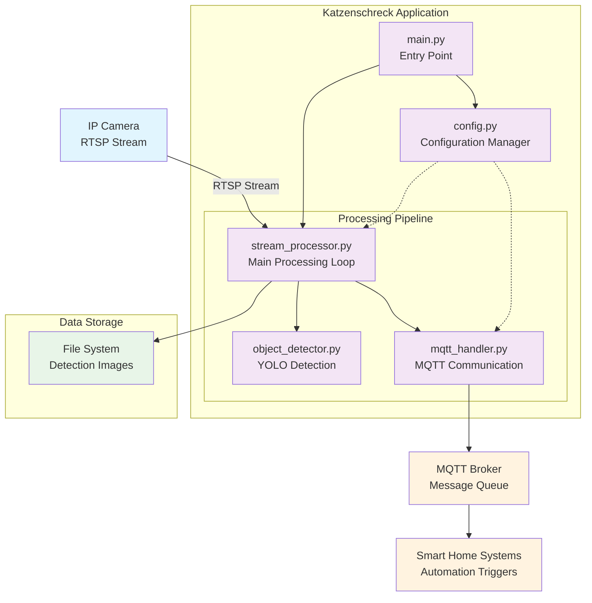

# Katzenschreck System Architecture

## High-Level Overview

```
┌─────────────────┐    ┌─────────────────┐    ┌─────────────────┐
│   IP Camera     │    │  Katzenschreck  │    │  Results folder │
│  (RTSP Stream)  │───▶│     System      │───▶│ (Detection JPGs)│
└─────────────────┘    └─────────────────┘    └─────────────────┘
                              │
                              ▼
                       ┌─────────────────┐
                       │  MQTT Broker    │
                       │  (Notifications)│
                       └─────────────────┘
                              │
                              ▼
                       ┌─────────────────┐
                       │  Smart Home     │
                       │  Integration    │
                       │ (Sprinkler etc.)│
                       └─────────────────┘
```

## Detailed System Architecture



## Component Details

### Core Modules

#### 1. **main.py** - Application Entry Point
- Argument parsing
- Application initialization
- Error handling and logging

#### 2. **config.py** - Configuration Management
- Configuration file parsing
- Environment variable handling
- Parameter validation

#### 3. **stream_processor.py** - Main Processing Engine
- RTSP stream handling
- Frame processing coordination
- Error recovery and reconnection

#### 4. **object_detector.py** - AI Detection Core
- YOLO model integration
- Cat detection algorithms
- Ignore zone filtering
- Confidence threshold management

#### 5. **mqtt_handler.py** - Real-time Communications
- MQTT broker connection
- Detection event publishing
- Health monitoring (ping)
- Message formatting

### Data Flow

1. **Input**: IP Camera streams video via RTSP
2. **Processing**: Stream processor captures frames
3. **Detection**: YOLO analyzes frames for cats
4. **Notification**: MQTT messages sent to smart home systems
5. **Storage**: Annotated detection images saved to the results folder in the background
6. **Action**: External systems (sprinklers) triggered

### Storage

Detection images are written as `frame_<timestamp>.jpg` to the results folder. When the root
partition exceeds `usage_threshold`, the oldest images are deleted.

## Deployment Architecture

### Option A: Native Deployment
```
┌─────────────────────────────────┐
│         Host System             │
│  ┌─────────────────────────────┐│
│  │    Python Virtual Env       ││
│  │  ┌─────────────────────────┐││
│  │  │   Katzenschreck App     │││
│  │  └─────────────────────────┘││
│  └─────────────────────────────┘│
└─────────────────────────────────┘
```

### Option B: Docker Deployment
```
┌─────────────────────────────────┐
│         Docker Host             │
│  ┌─────────────────────────────┐│
│  │   Katzenschreck Container   ││
│  │  ┌─────────────────────────┐││
│  │  │     Application         │││
│  │  │   + Dependencies        │││
│  │  └─────────────────────────┘││
│  └─────────────────────────────┘│
└─────────────────────────────────┘
```

## Integration Points

### External Systems
- **MQTT Brokers**: Mosquitto, HiveMQ, AWS IoT Core
- **Smart Home**: Home Assistant, OpenHAB, NodeRED
- **Cameras**: Any RTSP-compatible IP camera

### Network Requirements
- **RTSP**: Camera stream access
- **MQTT**: Port 1883 (unencrypted) or 8883 (TLS)
- **HTTP/HTTPS**: Optional for web interfaces

## Performance Characteristics

- **Frame Processing**: ~1-5 FPS (depending on hardware)
- **Detection Latency**: <2 seconds from capture to MQTT
- **Storage**: ~100KB per detection image
- **CPU Usage**: Moderate (YOLO inference)
- **Memory**: ~500MB-2GB (model dependent)

## Security Considerations

- MQTT authentication required
- RTSP stream credentials
- File system permissions
- Network isolation recommended
